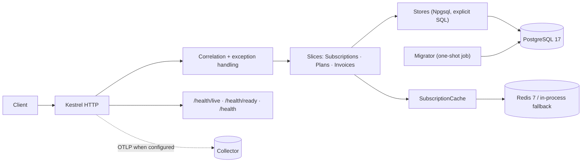
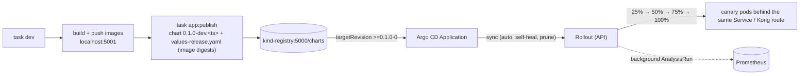
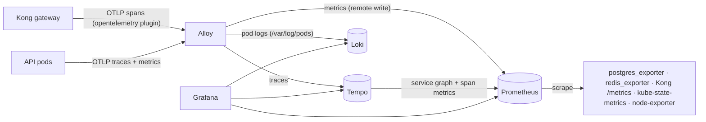

# Subscription Management — .NET 10, Vertical Slices, Native AOT

A subscription-billing API built with **Vertical Slice Architecture** on ASP.NET Core Minimal APIs, published as a **Native AOT** executable.
It started as a three-endpoint sample (create / get / cancel on an in-memory EF Core database) and was extended to feature parity with a
Spring Boot reference implementation: subscription lifecycle (pause / resume / renew), invoices, a plan catalog, keyset-paginated search,
RFC 9457 error responses, Redis caching, PostgreSQL persistence with versioned migrations, health probes and OpenTelemetry.

## Architecture



Each feature is a folder holding an `*Endpoint.cs` (route + binding) and an `*Handler.cs` (command/query record + logic). There is no mediator and no generic
repository: domain rules live in plain classes (`Subscription`, `Invoice`) and SQL lives in one `*Store` per table.
Design rationale: [docs/technical-design.md](docs/technical-design.md) · decisions: [docs/adr](docs/adr).

## Technology stack

| | Version |
|---|---|
| .NET SDK / runtime | 10.0.201 (pinned in `global.json`, `rollForward: latestFeature`) |
| ASP.NET Core | 10.0 — Minimal APIs, `CreateSlimBuilder`, source-generated JSON |
| PostgreSQL / driver | 17 / Npgsql 10.0.3 (no ORM) |
| Cache | Redis 7 via Microsoft.Extensions.Caching.StackExchangeRedis 10.0.12 (in-process fallback) |
| API docs | Microsoft.AspNetCore.OpenApi 10.0.12 + Scalar.AspNetCore 2.17.11 |
| Telemetry | OpenTelemetry 1.19.x (ASP.NET Core + Npgsql instrumentation, OTLP exporter) |
| Tests | xUnit 2.9.3, Testcontainers 4.15.0 (PostgreSQL, Redis), Microsoft.AspNetCore.Mvc.Testing 10.0.12 |

## Prerequisites

* .NET SDK 10.0.201+ (`dotnet --version`)
* Docker (integration tests, the AOT smoke test and `docker compose`)
* For Native AOT publishing on Linux: `clang` and `zlib1g-dev` (`sudo apt-get install clang zlib1g-dev`).
  If you only have `gcc`, add `-p:CppCompilerAndLinker=gcc`.

## Local development

```bash
docker compose up -d postgres redis                                   # backing services (localhost:5432 / :6379)
dotnet run --project src/SubscriptionManagement.Migrator -- \
  "Host=localhost;Database=subscriptions;Username=subs;Password=subs-dev-only"   # create/upgrade the schema
dotnet run --project src/SubscriptionManagement --launch-profile http # API on http://localhost:5127 (Scalar UI at /scalar)
```

Try the API with [SubscriptionManagement.http](SubscriptionManagement.http) (VS Code REST Client / Visual Studio).

### Endpoints

| Method | Path | Success | Notable errors |
|---|---|---|---|
| POST | `/subscriptions` | 201 + `Location` | 400 validation |
| GET | `/subscriptions/{id}` | 200 (cached) | 404 |
| DELETE | `/subscriptions/{id}` | 204 (row kept, status = 2) | 400 already canceled, 404 |
| POST | `/subscriptions/{id}/pause` · `/resume` | 200 | 409 invalid transition, 404 |
| POST | `/subscriptions/{id}/renew` | 200 `{subscription, invoice}` | 409, 404 |
| POST | `/subscriptions/search` | 200 `{items, nextCursor}` (keyset, default 20, max 100) | 400 bad status/cursor |
| GET | `/subscriptions/{id}/invoices` | 200 `{items}` newest first | 404 |
| GET · POST | `/invoices/{id}` · `/invoices/{id}/pay` | 200 | 404, 409 not payable |
| POST · GET | `/plans` · `/plans/{code}` · `/plans` (list) | 201 / 200 | 409 duplicate, 404 |
| GET | `/health/live` · `/health/ready` · `/health` | 200 `{"status":"UP"}` | 503 |

Subscription `status`: `1` Active, `2` Canceled, `3` Paused. Errors are `application/problem+json` (RFC 9457) with `type`
(`https://api.demo/errors/<slug>`), `title`, `status`, `detail`, `instance`, `timestamp`, `traceId` and, for validation, an `errors` map keyed by JSON field name.
Every response carries `X-Trace-Id` (an inbound value is honoured if it is a short printable token).

## Configuration

Standard ASP.NET Core configuration; environment variables use `__` for nesting.

| Key | Purpose | Default |
|---|---|---|
| `ConnectionStrings__Postgres` | **Required**; the app fails at startup without it | Development file: local compose DB |
| `ConnectionStrings__Redis` | Redis endpoint; empty ⇒ in-process cache | Development file: `localhost:6379` |
| `Cache__SubscriptionTtl` | Cached subscription lifetime | `00:05:00` |
| `OpenApi__Enabled` | Serve `/openapi/v1.json` and `/scalar` | `false` (`true` in Development) |
| `OTEL_EXPORTER_OTLP_ENDPOINT` (+ standard `OTEL_*`) | Enables trace/metric export | unset ⇒ telemetry off |
| `ASPNETCORE_URLS` / `ASPNETCORE_HTTP_PORTS` | Listening address (HTTP only) | 5127 (launch profile) / 8080 (container) |

The credentials in `appsettings.Development.json` and `compose.yaml` are local-development defaults only. Never reuse them; supply real values through
environment variables or your secret store. Without `POSTGRES_PASSWORD` set, compose uses the dev default.

## Database

Schema changes are versioned SQL files embedded in `src/SubscriptionManagement.Migrator/Migrations` (`V{n}__{description}.sql`, same tables as the Java reference).
The migrator applies pending files in order, records `version`/`checksum` in `schema_migrations`, refuses to run if an applied file was edited, and takes a PostgreSQL
advisory lock so concurrent runs are safe. The API never migrates on startup. In compose it runs as a one-shot service that the API waits for.
To add a migration, add `V5__what.sql`; never edit an applied one. Do not point this app at a database managed by the Java app's Flyway (different history table).

## Running tests

```bash
dotnet test                                                  # everything (needs Docker)
dotnet test tests/SubscriptionManagement.UnitTests           # fast, no Docker
dotnet test tests/SubscriptionManagement.IntegrationTests    # real PostgreSQL 17 + Redis 7 via Testcontainers
./scripts/aot-smoke.sh                                       # publish natively, run the native binaries, exercise the API
```

Integration tests host the real application with `WebApplicationFactory<Program>`; the schema is created by the real migrator; there is no EF InMemory and no mocking.
They cover every endpoint, error shapes, validation and malformed input, cache hits/eviction/TTL against real Redis and a Redis outage, concurrent cancels/payments/duplicate plans
(row locks), keyset paging with ties, correlation headers, health, OpenAPI on/off and migrator idempotence/tamper detection.

## Native AOT

**Why:** ~5× faster start, ~½ the memory and a ~61 MB image with no .NET runtime layer (see [docs/performance.md](docs/performance.md)).

**Constraints we accepted** (details: [docs/migration/native-aot-assessment.md](docs/migration/native-aot-assessment.md)):
* **EF Core is not used** — Microsoft documents EF Core Native AOT as experimental and advises against production use; data access is Npgsql + explicit SQL (ADR-002).
* No reflection-based libraries (FluentValidation replaced by explicit validators, ADR-004); every wire type is registered in `AppJsonSerializerContext`. **Adding an endpoint type ⇒ add a `[JsonSerializable]`.**
* Minimal APIs only (MVC is not AOT-compatible); HTTP only (`CreateSlimBuilder`), terminate TLS at the ingress.
* Analyzer warnings IL2026/IL2057/IL2067/IL2070/IL3050 are build errors; there are no suppressions.

```bash
dotnet publish src/SubscriptionManagement -c Release -r linux-x64 -o artifacts/api        # add -p:CppCompilerAndLinker=gcc if clang is absent
dotnet publish src/SubscriptionManagement.Migrator -c Release -r linux-x64 -o artifacts/migrator
ConnectionStrings__Postgres="Host=...;..." ./artifacts/api/SubscriptionManagement
./artifacts/api/SubscriptionManagement healthcheck            # exit 0/1; used by the container HEALTHCHECK
```

For a JIT build of the same code (e.g. to compare): `dotnet publish -p:PublishAot=false -p:EnableAotAnalyzer=false -p:EnableTrimAnalyzer=false`.

## Docker

```bash
podman compose up -d --build         # (or docker compose) postgres, redis, migrator (one-shot), api on http://localhost:8080
ENV_FILE=scripts/.env.compose scripts/load-test.sh   # k6 load test against localhost:8080 (VUS=, DURATION=, BASE_URL= to tune)
curl localhost:8080/health
podman compose down -v                 # also removes the database volume
```

Override host ports/credentials with `APP_PORT`, `POSTGRES_PORT`, `REDIS_PORT`, `POSTGRES_USER`, `POSTGRES_PASSWORD`, `POSTGRES_DB`, `OPENAPI_ENABLED`.
The images are multi-stage (`--target api|migrator`), built with clang, run on `runtime-deps:10.0-noble-chiseled` (no shell), as the non-root `app` user (UID 1654).

## Kubernetes (kind + Kong + Helm)

Requires docker, [kind](https://kind.sigs.k8s.io), kubectl, [Task](https://taskfile.dev) and helm (`task tools:helm` installs it into `~/.local/bin`).

```bash
task up                  # kind cluster → local registry → Kong (kong/ingress, DB-less) → metrics-server → monitoring → Argo CD + Rollouts → build, push, publish → Argo CD sync → test
task kong:port-forward   # only if the cluster was not created from deploy/kind/cluster.yaml (task cluster:ports tells you)
task smoke               # requests through Kong on http://127.0.0.1:9080 (Host: subs.localhost)
task dev                 # after a code change: rebuild, push, publish the chart; Argo CD syncs it and Argo Rollouts canaries the API
task rollout:watch       # follow the canary live (rollout:promote / rollout:abort / rollout:retry to steer it)
task registry:images     # what is in the local registry (repository:tag + digest)
task load-test           # k6 through Kong; also stress-test, locust-test (settings: scripts/.env, e.g. VUS=200 task load-test)
task grafana:open        # Grafana URL + login (http://grafana.localhost:9080, through Kong)
task argocd:open         # Argo CD (http://argocd.localhost:9080) + Rollouts dashboard URLs and the admin password
task down                # remove the release, monitoring and Kong;  task cluster:delete  removes the cluster
```

The test scripts read [scripts/.env](scripts/.env) (local k8s: `BASE_URL=http://127.0.0.1:9080`, `DOCKER_CONTEXT=default`, VUs/levels);
explicit variables win, and `ENV_FILE=scripts/.env.compose` targets the compose stack instead. Taskfile loads the same file.
`task --list` shows the rest (`app:logs`, `app:migrator-logs`, `app:psql`, `kong:routes`, `load-test`, …).
The chart ([deploy/helm/subscription-management](deploy/helm/subscription-management)) deploys the API (migrator as an init container — its
advisory lock makes concurrent replicas safe), PostgreSQL (StatefulSet + PVC), Redis, an Ingress for `ingressClassName: kong` with
KongPlugins (correlation-id on `X-Trace-Id`, rate-limiting, request-size-limiting), HPA, PDB and NetworkPolicies.
Defaults are in `values.yaml`; kind overrides in `values-local.yaml`; Kong's values in [deploy/kong/values.yaml](deploy/kong/values.yaml).
Images go through a local registry ([deploy/registry](deploy/registry), the `kind-registry` container on `localhost:5001`): the host pushes to
`localhost:5001/subscription-management[-migrator]`, and each kind node's containerd maps that name to the registry container over the `kind` network.

### GitOps and progressive delivery (Argo CD, Argo Rollouts)

`task argo:install` (part of `task up`) installs Argo CD ([deploy/argocd](deploy/argocd)) and Argo Rollouts ([deploy/argo-rollouts](deploy/argo-rollouts)).
The source of truth is an **OCI Helm chart in the local registry**, not a Git remote, so nothing leaves the machine:



* Every publish is a new chart version that pins both image digests, so the version Argo CD shows identifies exactly what runs.
* With `rollout.enabled` (values-local) the API is a `Rollout`: canary steps 25/50/75% with pauses, weight = share of canary pods
  (no traffic router; Kong balances across all pods). An `AnalysisTemplate` queries Prometheus for the **canary pods only**
  (`rollouts_pod_template_hash`, set from the pod label into the OTel resource): 5xx ratio ≤ 1% and p95 < 300 ms, health probes excluded.
  One failed measurement aborts the rollout and the stable version keeps serving.
* `task app:deploy` (plain Helm) still works on a cluster without Argo CD; once the Application exists it refuses, because Argo CD would revert it.
  `task gitops:adopt` hands an existing Helm release over to Argo CD without deleting anything.

### Monitoring (Grafana, Prometheus, Loki, Tempo)

`task monitoring:install` (part of `task up`, after Kong) deploys [deploy/observability](deploy/observability) into the `observability` namespace:



| | |
|---|---|
| Grafana | `http://grafana.localhost:9080` through Kong (`task grafana:open` prints the login), or `task grafana:port-forward` → `:3000` |
| Dashboards | *Subscription Management / Overview* (gateway vs API traffic and latency, 5xx, HPA, PostgreSQL, Redis, pod CPU/memory, logs, traces) — shipped by the app chart; *Community*: ASP.NET Core (19924/19925), Kong (7424), PostgreSQL (9628), Redis (763); plus the kube-prometheus-stack Kubernetes set |
| Traces | Kong span → ASP.NET Core → Npgsql in one trace (W3C `traceparent`); Tempo service map; latency exemplars and log `TraceId`s link to the trace |
| Alerts | `PrometheusRule` from the chart: API unavailable / 5xx > 5% / p95 > 500 ms, PostgreSQL down / connections > 80% / deadlocks, Redis down / memory > 90% (`task alertmanager:port-forward`) |
| Other UIs | `task prometheus:port-forward` (:9090), `task monitoring:status` (pods + scrape targets that are down) |

The app side is switched on in `values-local.yaml`: `config.otlpEndpoint` (Alloy), exporter sidecars (`postgresql.metrics`, `redis.metrics`),
`metrics.serviceMonitor`, `metrics.prometheusRule`, `metrics.grafanaDashboard`. With `networkPolicy.enabled`, only the `observability` namespace may scrape the exporters.

Sizing notes (laptop defaults): 10% of requests are traced (Kong `tracing_sampling_rate: 0.1` in deploy/kong/values.yaml; the API follows
the sampled flag). At 100%, a load test produced trace blocks whose compaction OOM-killed Tempo on every start; set 1.0 only while debugging.
Tempo's ingestion limits, Alloy's memory limiter and its small export queue shed spans under pressure instead of failing — metrics stay complete. Kong's 2xx/3xx access-log lines
are dropped before Loki (they are already counted and traced); 4xx/5xx and gateway errors are kept. Retention: Prometheus 3 d, Loki 72 h, Tempo 48 h.

## Project structure

```
src/SubscriptionManagement/            API: Program.cs, Features/{Subscriptions,Plans,Invoices}, Infrastructure/
src/SubscriptionManagement.Migrator/   SQL migration runner + embedded V*.sql
tests/SubscriptionManagement.UnitTests/         domain, validators, cursor codec, problem writer
tests/SubscriptionManagement.IntegrationTests/  Testcontainers + WebApplicationFactory
scripts/                               aot-smoke.sh, measure-startup.sh, load/stress tests
deploy/                                helm chart, Kong, kind config, local registry, observability, Argo CD/Rollouts (driven by Taskfile.yml)
docs/                                  technical-design, implementation-plan, migration/*, adr/*, performance
```

## Observability

* **Logging:** structured JSON to stdout with scopes (`traceId`, request path). Unhandled errors are logged once with the trace id and returned as an opaque 500 problem.
* **Tracing/metrics:** set `OTEL_EXPORTER_OTLP_ENDPOINT` (and `OTEL_EXPORTER_OTLP_PROTOCOL=http/protobuf` if your collector expects HTTP) to export ASP.NET Core and Npgsql telemetry. On Kubernetes this is wired to Grafana/Tempo/Prometheus — see [Monitoring](#monitoring-grafana-prometheus-loki-tempo).
* **Health:** `/health/live` (process), `/health/ready` (database — deliberately not Redis, as in the reference), `/health` (database + cache). Bodies contain only `{"status":"UP|DOWN"}`.
* **Correlation:** `X-Trace-Id` in/out, and as `traceId` in every problem response.

## Troubleshooting

| Symptom | Cause / fix |
|---|---|
| Publish fails: `Platform linker not found` / `clang` | `sudo apt-get install clang zlib1g-dev`, or `-p:CppCompilerAndLinker=gcc` |
| API exits: `ConnectionStrings:Postgres is not configured` | Set `ConnectionStrings__Postgres` (fail-fast by design) |
| `relation "subscriptions" does not exist` | Run the migrator first |
| Migrator: `Migration V2 ... was modified after it was applied` | An applied `V*.sql` was edited; restore it and add a new version instead |
| Native binary returns 500 with `JsonTypeInfo metadata ... was not provided` | A new request/response type is missing from `AppJsonSerializerContext` |
| `X-Trace-Id` missing from error responses in your own middleware | `UseExceptionHandler` clears response headers; set headers in `Response.OnStarting` (as `CorrelationMiddleware` does) |
| Integration tests: Docker errors | The tests need a running Docker daemon; `docker info` |
| Test overrides of `OpenApi:Enabled` ignored | `Program` reads it while building; use `WebApplicationFactory.UseSetting`, not `ConfigureAppConfiguration` |
| Old `https` launch profile missing | `CreateSlimBuilder` has no HTTPS; terminate TLS at the ingress or call `UseKestrelHttpsConfiguration` |
| Search/GET 500 on a row with a 29-digit price written by another system | Npgsql cannot read such `NUMERIC(57,28)` values into `decimal`; this API rejects prices ≥ 10^28 on create |
| `dotnet publish -p:PublishAot=false` reports IL2026 errors | The AOT analyzers are forced on in the csproj; add `-p:EnableAotAnalyzer=false -p:EnableTrimAnalyzer=false` for JIT-only publishes |

## Compatibility notes vs. the original sample

Status codes and the six subscription response fields are unchanged. Differences: persistence is PostgreSQL (needs a database), errors are problem+json
(the old `{"error": ...}` text is preserved in `detail` and an `error` member), validation error keys are camelCase JSON names (previously PascalCase),
a missing `startDate` is now a 400 instead of silently binding to `0001-01-01`, and `status` may now be `3` (Paused). See
[docs/migration/java-feature-gap.md](docs/migration/java-feature-gap.md) §4.

## License

See [LICENSE](LICENSE).
