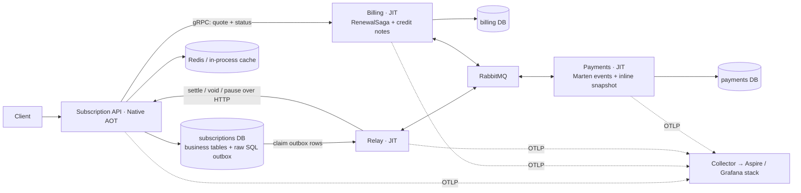
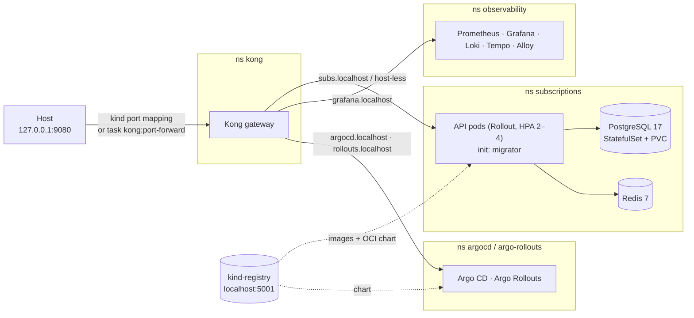
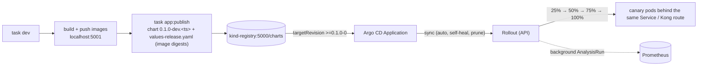
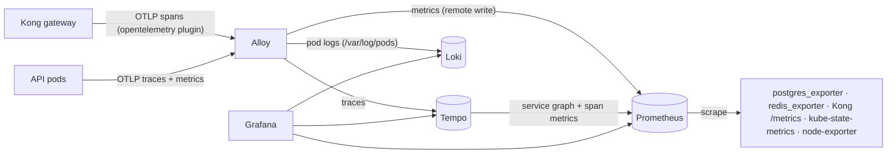

# Subscription Management — .NET 10, Vertical Slices, Native AOT

A subscription-billing API built with **Vertical Slice Architecture** on ASP.NET Core Minimal APIs, published as a **Native AOT** executable.
It started as a three-endpoint sample (create / get / cancel on an in-memory EF Core database) and was extended to feature parity with a
Spring Boot reference implementation: subscription lifecycle (pause / resume / renew), invoices, a plan catalog, keyset-paginated search,
RFC 9457 error responses, Redis caching, PostgreSQL persistence with versioned migrations, health probes and OpenTelemetry.
Aspire also runs three JIT services: Billing (gRPC and renewal orchestration), Payments (event-sourced payments), and Relay
(transactional outbox and API commands), connected through RabbitMQ with Wolverine.

It also ships a complete **local Kubernetes platform** (kind): Helm chart behind a Kong gateway, a local image registry, Grafana/Prometheus/Loki/Tempo
monitoring, and GitOps with Argo CD plus canary releases through Argo Rollouts — all driven by [Taskfile.yml](Taskfile.yml) (`task up`).
See [Kubernetes](#kubernetes-kind--kong--helm).

## Architecture



In the API, each feature is a folder holding an `*Endpoint.cs` (route + binding) and an `*Handler.cs` (command/query record + logic). There is no mediator and no generic
repository: domain rules live in plain classes (`Subscription`, `Invoice`) and SQL lives in one `*Store` per table.
Design rationale: [docs/technical-design.md](docs/technical-design.md) · decisions: [docs/adr](docs/adr).

## Technology stack

| | Version |
|---|---|
| .NET target | `net10.0` (`global.json` is currently absent; use a .NET 10 SDK) |
| ASP.NET Core | 10.0 — Minimal APIs, `CreateSlimBuilder`, source-generated JSON |
| PostgreSQL / driver | 17 / Npgsql 10.0.3 (explicit SQL in the API) |
| Service messaging / persistence | RabbitMQ 4.3-management, Wolverine 6.64.0, EF Core PostgreSQL provider 10.0.3 (Billing/Relay), Marten 9.59.0 (Payments) |
| Service contracts | gRPC 2.85.0, Google.Protobuf 3.36.2; generated client in API, server in Billing |
| Local orchestration | Aspire 13.6.5 |
| Cache | Redis 7 via Microsoft.Extensions.Caching.StackExchangeRedis 10.0.12 (in-process fallback) |
| API docs | Microsoft.AspNetCore.OpenApi 10.0.12 + Scalar.AspNetCore 2.17.11 |
| Telemetry | OpenTelemetry 1.19.x (ASP.NET Core + Npgsql instrumentation, OTLP exporter) |
| Tests | xUnit 2.9.3, Testcontainers 4.15.0 (PostgreSQL, Redis, RabbitMQ), Microsoft.AspNetCore.Mvc.Testing 10.0.12 |
| Load tests | k6 (smoke, load, stress, spike, soak, rampup, breakpoint, contention, pagination, saga), Locust — run in containers by `scripts/*.sh` or as Aspire resources |

Local Kubernetes platform (versions pinned in `Taskfile.yml` and `deploy/`):

| Component | Chart | App |
|---|---|---|
| kind / kubectl / Helm | — | kind 0.32 (node v1.36), Helm v4.3.1 (`task tools:helm`) |
| Kong Ingress Controller + Gateway (DB-less) | `kong/ingress` 0.24.0 | Kong 3.9, KIC 3.5 |
| Local registry | — | `registry:3` container `kind-registry` on `localhost:5001` |
| metrics-server | 3.14.0 | — |
| Prometheus, Alertmanager, Grafana | `kube-prometheus-stack` 92.11.0 | Prometheus 3.15, Grafana 13.2 |
| Loki / Tempo / Alloy | `grafana-community/loki` 19.2.0 / `grafana-community/tempo` 3.2.1 / `grafana/alloy` 1.14.3 | Loki 3.7, Tempo 3.1, Alloy 1.21 |
| Exporters (sidecars) | — | postgres_exporter v0.20.1, redis_exporter v1.96.0 |
| Argo CD / Argo Rollouts | `argo-cd` 10.11.1 / `argo-rollouts` 2.43.8 | v3.5.6 / v1.10.1 (+ kubectl plugin) |

## Prerequisites

* .NET 10 SDK (`dotnet --version`; local service verification used 10.0.401)
* Docker (integration tests, the AOT smoke test and `docker compose`)
* For Native AOT publishing on Linux: `clang` and `zlib1g-dev` (`sudo apt-get install clang zlib1g-dev`).
  If you only have `gcc`, add `-p:CppCompilerAndLinker=gcc`.
* For the Kubernetes platform: [kind](https://kind.sigs.k8s.io), kubectl, [Task](https://taskfile.dev) v3 and Helm (`task tools:check`).
  Roughly 6–8 GB of free RAM for the whole stack (app + monitoring + Argo).

## Local development

```bash
docker compose up -d postgres redis                                   # backing services (localhost:5432 / :6379)
dotnet run --project src/SubscriptionManagement.Migrator -- \
  "Host=localhost;Database=subscriptions;Username=subs;Password=subs-dev-only"   # create/upgrade the schema
dotnet run --project src/SubscriptionManagement.Api --launch-profile http # API on http://localhost:5127 (Scalar UI at /scalar)
```

Try the API with [SubscriptionManagement.http](SubscriptionManagement.http) (VS Code REST Client / Visual Studio).

### With Aspire (one command, dashboard included)

[Aspire](https://aspire.dev) 13.6.5 runs PostgreSQL 17, Redis 7, RabbitMQ, the migrator, the API and the three JIT services
from source. The dashboard and orchestrator come from NuGet; a container engine and the .NET SDK are required.
The s2s topology is wired here; `compose.yaml` and the Helm chart still run the API/migrator/Postgres/Redis topology.

```bash
dotnet run --project src/AppHost                         # http profile (default, no dev cert needed)
dotnet run --project src/AppHost --launch-profile https  # https: needs a *trusted* dev certificate, see below
```

The `https` profile fails with `UntrustedRoot` ("Error connecting to the resource service") until the ASP.NET Core
development certificate is trusted. On Linux:

```bash
dotnet dev-certs https --trust     # writes the cert to ~/.aspnet/dev-certs/trust (+ browser NSS stores)
export SSL_CERT_DIR="$HOME/.aspnet/dev-certs/trust:${SSL_CERT_DIR:-/usr/lib/ssl/certs}"   # e.g. in ~/.zshrc, then restart the IDE/shell
```

The console prints the dashboard login URL (`http://localhost:15043` on the http profile). The API stays on
`http://localhost:5127` (Scalar at `/scalar`, also linked from the dashboard), so `SubscriptionManagement.http` works
unchanged. `billing` waits for `billing-db` and `messaging`; `payments` waits for `payments-db` and `messaging`.
The API waits for Billing, Redis and the successful migrator; `relay` then waits for the API, migrator and broker.
The long-running projects are health-checked on `/health/ready`; when monitoring is enabled they also wait for the collector.

| Resource | Owns / exposes |
|---|---|
| `postgres` → `subscriptions`, `billing-db`, `payments-db` | One PostgreSQL instance; database names `subscriptions`, `billing`, `payments` |
| `messaging` | RabbitMQ 4.3 with management plugin and a persistent data volume; management URL is in Aspire |
| `billing` | gRPC HTTP/2 on `http://localhost:5138`; REST/probes HTTP/1.1 on `http://localhost:5128` |
| `payments` | Payment snapshot and event reads on `http://localhost:5129` |
| `relay` | Outbox draining and broker-to-HTTP commands; grouped under the API in Aspire |
| `k6-saga` | On-demand s2s scenario; waits for Billing, Payments and Relay |

Postgres and RabbitMQ data survive restarts in volumes; do not delete the volumes to rerun a scenario. Generated
credentials are managed by Aspire/user secrets. The AppHost lives in `src/AppHost/AppHost.cs` and `Services.cs`;
shared OpenTelemetry setup lives in `src/SubscriptionManagement.ServiceDefaults`.
Connection budgets cover the whole PostgreSQL instance: API pool 900 + three service pools × 20 = 960, below
1000 − 3 reserved slots, with capacity left for migrations, exporters and interactive sessions.

The AppHost's operational settings live in `src/AppHost/appsettings.json`; override any of them with
`--Section:Key=value`, an environment variable (`Section__Key`) or user secrets:

| Setting | Default | Meaning |
|---|---|---|
| `Postgres:MaxConnections` | 1000 | PostgreSQL `max_connections` |
| `Api:PostgresMaxPoolSize` | 900 | API pool; startup requires API pool + 3 × service pool < `MaxConnections` − 3 |
| `Api:OutboxEnabled` | true | Sets the API's `Outbox:Enabled`; enables renewal/cancellation events in Aspire |
| `Services:PostgresMaxPoolSize` | 20 | Pool per Billing, Payments and Relay; shared with each service's message persistence |
| `Billing:RenewalTimeoutSeconds` | 30 | Durable local timeout while the saga awaits payment |
| `Billing:TaxRate` | 0.10 | Quote tax fraction, added to the subscription price (USD) |
| `Gateway:DeclineAtOrAbove` | 5000 | Simulated gateway declines charged totals at/above this amount |
| `Gateway:NoReplyAtOrAbove` | 9000 | Simulated gateway records the request but sends no reply; checked before decline |
| `Relay:PollIntervalMs` | 250 | Delay after a non-full outbox batch |
| `Relay:BatchSize` | 100 | Maximum raw outbox rows transferred per transaction |
| `Observability:Enabled` | true | Prometheus/Tempo/Loki/Grafana stack next to the Aspire dashboard |
| `Observability:GrafanaPort` / `PrometheusPort` | 3000 / 9190 | Fixed host ports (`scripts/.env.aspire` points k6 at the Prometheus one) |
| `Observability:PrometheusRetention` | 7d | Prometheus TSDB retention |
| `LoadTest:AutoStart` | (empty) | Comma-separated k6 scenarios to start with the app |
| `LoadTest:<name>:<KNOB>` | `load`/`stress`: 2000 VUs | Knobs of a k6 scenario (see each script's header) |
| `LoadTest:saga:ITERATIONS` | 3 | Fresh success/decline/timeout/refund cases per iteration, one VU |
| `LoadTest:saga:RENEWAL_TIMEOUT_S` | 30 | Must match `Billing:RenewalTimeoutSeconds`; client polling adds 30 s delivery margin |

#### Monitoring and load testing (Grafana)

By default the AppHost also starts a monitoring stack for load tests (`src/AppHost/Observability.cs`, configs in
`src/AppHost/observability/`):

```
API / migrator / billing / payments / relay ──OTLP──► OpenTelemetry Collector ─┬─► Aspire dashboard   (logs, traces, metrics)
                                                  ├─► Prometheus         (metrics, native OTLP receiver)
                                                  ├─► Tempo              (traces → span metrics + service graph → Prometheus)
                                                  └─► Loki               (logs, native OTLP)
postgres-exporter, redis-exporter, RabbitMQ ◄── scraped by Prometheus;  k6 ──remote write──► Prometheus
Grafana ◄── Prometheus + Tempo + Loki (exemplars → traces, traces → logs/metrics, logs → traces)
Grafana ──render──► grafana-image-renderer (headless Chromium) ──loads the panel──► Grafana
```

| URL | What |
|---|---|
| http://localhost:3000 | Grafana — anonymous viewing + Explore; sign in as `admin` / `admin` to edit |
| http://localhost:9190 | Prometheus (host port 9190: 9090 is often taken) |

Panels and dashboards can be exported as PNG from Grafana's share/export menus — handy for attaching a load-test
result to a report. The [image renderer](https://grafana.com/grafana/plugins/grafana-image-renderer/) runs as its own
container (`grafana-renderer`) with a token generated per run. The same thing over HTTP:

```bash
# one panel (panelId = the panel's "id" in the dashboard JSON) and the whole dashboard
curl -o panel.png     'http://localhost:3000/render/d-solo/subs-aspire-service/_?panelId=11&from=now-30m&to=now&width=1000&height=500'
curl -o dashboard.png 'http://localhost:3000/render/d/subs-aspire-loadtest/_?from=now-30m&to=now&width=1600&height=1000&kiosk=true'
```

Provisioned dashboards (folder *Subscription Management*), generated from the real metric names:

* **Subscription Management — Service**: RED per route (req/s, 4xx/5xx ratio, p50/p95/p99 with exemplars → Tempo,
  latency heatmap, per-route table), Kestrel connections/queue, exceptions, .NET runtime (CPU, memory, allocation rate,
  GC collections and pause time, thread pool threads/queue, lock contention), Npgsql pool (used/idle vs max, pending
  requests, command p95, commands/s), PostgreSQL server (connections vs `max_connections`, TPS, rows, cache hit ratio,
  locks, deadlocks), Redis (commands, hit ratio, latency, memory, clients), Tempo service graph, slow/error traces,
  logs by level, and the collector's own pipeline health (exports, failures, queue usage).
* **Subscription Management — Load test (k6)**: VUs vs client/server throughput, client p95/p99 per scenario, client vs
  server latency, request phases (blocked/connecting/waiting …), status codes, checks — next to the service's
  saturation signals (CPU, GC, in-flight requests, Kestrel and thread-pool queues, Npgsql pool, Postgres connections)
  and the error logs; plus per-endpoint client throughput/p95, dropped iterations (open-model tests), correctness
  violations (contention, pagination) and journey / first-vs-deep-page latency.
* **Subscription Management — Request flow**: service graph and edge/operation RED metrics, invoice-filtered traces,
  messaging traffic, RabbitMQ backlog, Wolverine failures/inbox/outbox/scheduled messages and logs.

To follow one renewal, run `k6-saga` and copy `invoiceId` and `traceId` from its JSON console lines. Open
[Request flow](http://localhost:3000/d/subs-aspire-request-flow), keep **Service = All**, set **Invoice id**, and select
a time range containing the run. Open the trace returned by **Follow one renewal**; alternatively paste the logged
`traceId` into Grafana Explore with the Tempo datasource. Inspect the API/gRPC/outbox/handler/HTTP spans, then use the
trace-to-logs link. `invoice.id` marks the API spans and `wolverine.saga.id` marks the saga handler spans; invoice ids
are trace attributes, not Prometheus labels. Broker delivery and durable dispatch can add spans at different times,
so allow the collector and Tempo to ingest them before inspecting the waterfall.
Live verification found a connected renewal trace across all four services, including the gRPC client span, and five
messaging edges in the service graph. Error/dead-letter panels require failing traffic; a healthy saga run can leave them empty.

#### k6 scenarios

The scenarios live in `scripts/*-test.js` (shared helpers in `scripts/lib/api.js`) and are the single source of truth:
the same files run as Aspire resources or from the host. The existing API scenarios also run against compose/Kubernetes;
`saga` and the s2s part of `endpoints` (`S2S=true`) require the s2s services, currently wired by Aspire.

| Scenario | Question it answers | Shape (defaults) | Passes when |
|---|---|---|---|
| `smoke` | Is the stack sane? Every endpoint and the whole error contract | 1 VU × 3 iterations | every check passes, no unexpected failure |
| `load` | How does each endpoint behave under normal load? | 6 scenarios in sequence, 2000 VUs × 20 s | <1% failures, p95 < 100–200 ms per scenario |
| `stress` | What happens at one high, constant load? | 2000 VUs × 60 s, mixed workload | (no thresholds; `stress-test.sh` runs the VU ladder) |
| `spike` | Does it survive a burst, and what do regular users feel meanwhile? | 20 steady VUs + two bursts of 400 VUs | <1% failures, steady users p95 < 500 ms |
| `soak` | Does anything degrade over time (memory, GC, pools, Redis)? | 100 iterations/s for 10 min (use 1 h+) | <0.5% failures, p95 < 300 ms, <1% dropped |
| `rampup` | How do latency and throughput change as users build up gradually? | VUs ramp 50 → 2000 over 5 min, hold 1 min | <1% failures, p95 < 1 s |
| `breakpoint` | Where is the limit? | rate ramps 50 → 3000/s over 5 min | **aborts** at the limit (exit 99 is the result) |
| `contention` | Is it still correct when clients race the same row? | 8 racers per pay / cancel / create-plan | exactly one winner, always |
| `pagination` | Does keyset paging stay consistent and flat under writes? | 20 readers walking 10 pages + 2 writers | no duplicate/out-of-order row, deep page p95 < 200 ms |
| `saga` | Do renewal orchestration and cancel/refund choreography settle correctly? | 1 VU × 3 iterations, prices 10 / 6000 / 9500 | checks >99%, zero unexpected HTTP errors or saga failures; records `saga_settle_ms` |
| `endpoints` | Does every route hold up when all of them are used at once, and is any route missing from the load tests? | 7 parallel flows (catalog, reads, lifecycle, invoices incl. the Relay's settle/void, errors, health, + saga with `S2S=true`), 40 VUs × 1 min | checks >99%, <1% failures, p95 < 1 s, **every route called at least once** (`calls_<name>` metric per route), zero saga failures |

Each script documents its knobs in its header (`SPIKE_VUS`, `SOAK_DURATION`, `RAMPUP_VUS`, `BP_MAX_RATE`, `ENDPOINTS_VUS`, …). Three ways to run one:

* **From the Aspire dashboard**: resources `k6-<scenario>` ([Community Toolkit k6 integration](https://aspire.dev/integrations/devtools/k6/k6-get-started/),
  `src/AppHost/LoadTests.cs`) sit under the API and are not started with the app; press ▶ (again for every run) and
  open the Load test dashboard. A resource that exits non-zero failed its thresholds. Knobs:
  `--LoadTest:spike:SPIKE_VUS=800 --LoadTest:soak:SOAK_DURATION=1h`; `--LoadTest:AutoStart=smoke,load` starts scenarios
  right after startup.
* **From the host** against the Aspire-hosted API: `task aspire:k6 -- spike` (= `ENV_FILE=scripts/.env.aspire
  scripts/k6-test.sh spike`), e.g. `SOAK_DURATION=1h task aspire:k6 -- soak`. With `K6_PROMETHEUS_RW_SERVER_URL` set
  (the Aspire env file does) k6 also remote-writes to Prometheus; a JSON summary lands in `artifacts/k6/`.
* **Against compose or Kubernetes**: `ENV_FILE=scripts/.env.compose scripts/k6-test.sh smoke`, `task k6 -- smoke`.

Run the complete saga suite (including a real timeout) with:

```bash
dotnet run --project src/AppHost -- --LoadTest:AutoStart=saga
# A shorter timeout: change both the service and polling settings together.
dotnet run --project src/AppHost -- --LoadTest:AutoStart=saga --Billing:RenewalTimeoutSeconds=10 --LoadTest:saga:RENEWAL_TIMEOUT_S=10
# Against an already running AppHost:
ENV_FILE=scripts/.env.aspire scripts/k6-test.sh saga
```

The host runner forwards `ITERATIONS`, `RENEWAL_TIMEOUT_S`, `BILLING_URL`, `PAYMENTS_URL`, `BASE_URL` and `HTTP_TIMEOUT`.
`BILLING_URL` is the HTTP REST port (5128), not gRPC (5138). Aspire injects service URLs into `k6-saga` automatically;
for a host run, `scripts/.env.aspire` supplies localhost URLs (use `host.docker.internal` with Docker Desktop).
Every iteration creates fresh subscriptions with current dates, keeps history, then cancels the successfully paid one.
It checks `Completed` + PAID and `[ChargeRequested, ChargeCaptured]`, `Declined` + VOID + PAUSED, `TimedOut` + VOID + PAUSED
and a final `ChargeCanceled`, then one credit note and a final `ChargeRefunded`. Settlement-rejected compensation is
covered by the service tests; the gateway has no deterministic live trigger for it.

k6 metrics drop the `url`/`name` tags (they carry entity ids → one series per request); the scripts tag every request
with its route template instead (`endpoint`, e.g. `GET /subscriptions/{id}`), which the Load test dashboard uses for
the per-endpoint panels. Expected error responses (404/409/400 in the contract and race tests) are declared as such, so
they do not count as failed requests. Plans cannot be deleted, so the scenarios create only a handful of them.
k6's Prometheus remote-write output is deprecated upstream (removal planned for k6 v3) in favour of its OpenTelemetry
output; it works on the pinned k6 2.x.

Prometheus/Tempo/Loki keep data only for the life of their containers. For a lean run without the stack (Aspire
dashboard only, k6 resources still available): `dotnet run --project src/AppHost -- --Observability:Enabled=false`.

### Endpoints

| Method | Path | Success | Notable errors |
|---|---|---|---|
| POST | `/subscriptions` | 201 + `Location` | 400 validation |
| GET | `/subscriptions/{id}` | 200 (cached) | 404 |
| DELETE | `/subscriptions/{id}` | 204 (row kept, status = 2) | 400 already canceled, 404 |
| POST | `/subscriptions/{id}/pause` · `/resume` | 200 | 409 invalid transition, 404 |
| POST | `/subscriptions/{id}/renew` | 200 `{subscription, invoice}` | 409, 404 |
| POST | `/subscriptions/{id}/renewals` | 202 `{subscription, invoice}` + `Location: /invoices/{id}/renewal` | 404, 409, 503 billing/outbox unavailable |
| GET | `/invoices/{id}/renewal` | 200 `{invoiceId, paymentId, state, failureReason, updatedAt}` | 404 until saga consumes the invoice; 503 Billing unavailable |
| POST | `/invoices/{id}/settle` | 200 invoice; JSON body `{"paymentId":"<uuid>"}` | 400 missing paymentId, 404, 409 conflicting payment/state |
| POST | `/invoices/{id}/void` | 200 invoice | 404, 409 invoice already paid |
| POST | `/subscriptions/search` | 200 `{items, nextCursor}` (keyset, default 20, max 100) | 400 bad status/cursor |
| GET | `/subscriptions/{id}/invoices` | 200 `{items}` newest first | 404 |
| GET · POST | `/invoices/{id}` · `/invoices/{id}/pay` | 200 | 404, 409 not payable |
| POST · GET | `/plans` · `/plans/{code}` · `/plans` (list) | 201 / 200 | 409 duplicate, 404 |
| GET | `/health/live` · `/health/ready` · `/health` | 200 `{"status":"UP"}` | 503 |

Billing also exposes `GET /credit-notes?subscriptionId=<uuid>` → 200 `{items}` (empty until a refund).
Payments exposes `GET /payments/{id}` → the current snapshot and `GET /payments/{id}/events` → `{items}` in stream order,
each item carrying `version`, `type`, `data`, `timestamp`; both return 404 before a stream exists.
All three JIT services expose `/health/live` and `/health/ready`; these use ASP.NET health-check responses rather than
the API's JSON health body. Billing's `billing.v1.BillingService` has `GetRenewalQuote` and `GetRenewal` RPCs; decimals
are invariant strings, dates `yyyy-MM-dd`, and API calls have a two-second deadline.

`/renew` and manual `/pay` retain their existing behaviour. `/renewals` quotes before opening the database transaction,
then advances the period and commits the invoice/outbox row together. Settlement with the same payment id and repeated
voids are idempotent. The API remains the only writer of subscriptions/invoices; Relay calls these HTTP endpoints.
These endpoints have no authentication, including settlement and void; use this local sample within a trusted environment.

Subscription `status`: `1` Active, `2` Canceled, `3` Paused. Errors are `application/problem+json` (RFC 9457) with `type`
(`https://api.demo/errors/<slug>`), `title`, `status`, `detail`, `instance`, `timestamp`, `traceId` and, for validation, an `errors` map keyed by JSON field name.
Every response carries `X-Trace-Id` (an inbound value is honoured if it is a short printable token).

## Configuration

Standard ASP.NET Core configuration; environment variables use `__` for nesting.

| Key | Purpose | Default |
|---|---|---|
| `ConnectionStrings__Postgres` | **Required**; the app fails at startup without it | Development file: local compose DB |
| `ConnectionStrings__Redis` | Redis endpoint; empty ⇒ in-process cache | Development file: `localhost:6379` |
| `Cache__SubscriptionTtl` | Cached subscription lifetime | `00:05:00` |
| `Billing__GrpcAddress` | Optional Billing gRPC HTTP/2 address; absent ⇒ new billing calls return 503 | unset (Aspire injects `http://…:5138`) |
| `Outbox__Enabled` | Writes InvoiceIssued / eligible SubscriptionCanceled in the business transaction | false (Aspire sets true) |
| `OpenApi__Enabled` | Serve `/openapi/v1.json` and `/scalar` | `false` (`true` in Development) |
| `OTEL_EXPORTER_OTLP_ENDPOINT` (+ standard `OTEL_*`) | Enables trace/metric export | unset ⇒ telemetry off |
| `ASPNETCORE_URLS` / `ASPNETCORE_HTTP_PORTS` | Listening address (HTTP only) | 5127 (launch profile) / 8080 (container) |

For standalone JIT services, set `ConnectionStrings__Postgres` to their own database (Relay uses `subscriptions`) and
`ConnectionStrings__messaging` to RabbitMQ. Relay's `Api__BaseUrl` defaults to `http://localhost:5127`.
Billing/Gateway/Relay knobs have the same names/defaults as the AppHost table above. Billing configures separate
`Kestrel:Endpoints:http` (HTTP/1.1) and `Kestrel:Endpoints:grpc` (HTTP/2 without TLS); do not combine them on a cleartext port.

The credentials in `appsettings.Development.json` and `compose.yaml` are local-development defaults only. Never reuse them; supply real values through
environment variables or your secret store. Without `POSTGRES_PASSWORD` set, compose uses the dev default.

## Database

Schema changes are versioned SQL files embedded in `src/SubscriptionManagement.Migrator/Migrations` (`V{n}__{description}.sql`, the Java-compatible baseline plus .NET extensions).
The migrator is [DbUp](https://github.com/dbup/dbup) (Native AOT compatible) with two additions it lacks: a journal over `schema_migrations` that records `version`/`checksum`
in the script's own transaction and refuses to run if an applied file was edited, and a PostgreSQL advisory lock so concurrent runs are safe. Files are ordered by
version number (V10 after V2), and databases migrated before DbUp keep their history. The API never migrates on startup. In compose it runs as a one-shot service that the API waits for.
V6 adds `outbox_messages` (payload/type/traceparent/time) and nullable `invoices.payment_id`.
To add a migration, add the next version (currently `V7__what.sql`); never edit an applied one. Do not point this app at a database managed by the Java app's Flyway (different history table).

Billing's `renewal_sagas` (invoice id = saga id, retained terminal state, optimistic concurrency) and `credit_notes`
(unique payment id) live in database `billing`; Wolverine manages their schema at startup. Payments uses Marten's
`payments` schema in database `payments` for event streams, inline snapshots and durable envelopes. Relay only owns
the `relay` envelope schema in `subscriptions`; its raw-outbox deletion and Wolverine envelope insertion share one transaction.
Delivery is at least once; handlers use idempotent state transitions. Unknown outbox types stay queued and produce a
bounded warning; a corrupt known payload rolls its whole batch back for retry.
Billing declares and binds the outgoing ChargePayment, CancelPayment, SettleInvoice and CancelRenewal queues at startup;
Payments does the same for PaymentSucceeded, PaymentFailed and PaymentRefunded. This protects first-start delivery
when a consumer has not yet provisioned its own queue; the outgoing object collections alone do not expose every type
to startup discovery.

### Service workflows

```mermaid
sequenceDiagram
  participant C as Client
  participant A as AOT API
  participant R as Relay
  participant Q as RabbitMQ
  participant B as Billing saga
  participant P as Payments
  C->>A: POST /subscriptions/{id}/renewals
  A->>B: gRPC GetRenewalQuote (2 s deadline)
  B-->>A: Price + tax
  A->>A: Commit invoice + InvoiceIssued outbox row
  A-->>C: 202 + invoice id
  R->>R: Raw outbox → durable envelope in one transaction
  R->>Q: InvoiceIssued
  Q->>B: Start AwaitingPayment; schedule durable local timeout
  B->>Q: ChargePayment
  Q->>P: ChargePayment
  alt Captured
    P->>Q: PaymentSucceeded
    Q->>B: Move to Settling
    B->>Q: SettleInvoice
    Q->>R: SettleInvoice
    R->>A: POST /invoices/{id}/settle
    alt Settlement accepted
      R->>Q: InvoiceSettled
      Q->>B: Completed (row kept)
    else Settlement rejected (404/409)
      R->>Q: InvoiceSettlementRejected
      Q->>B: Compensated
      B->>Q: CancelPayment
      Q->>P: Refund captured payment
    end
  else Declined
    P->>Q: PaymentFailed
    Q->>B: Declined → CancelRenewal
    B->>Q: CancelRenewal
    Q->>R: Void invoice, then pause via API
    R->>A: POST void, POST pause
  else No gateway reply
    B->>B: RenewalTimeout while AwaitingPayment → TimedOut
    B->>Q: CancelPayment + CancelRenewal
    Q->>P: Append ChargeCanceled (or refund if captured)
    Q->>R: Void invoice, then pause via API
    R->>A: POST void, POST pause
  end
```

The timeout acts only in `AwaitingPayment`; a saga in `Settling` relies on Relay retry/dead-letter handling instead.
A permanent API outage can therefore leave `Settling` for operator recovery. Terminal rows are kept for polling;
late/duplicate replies do not change them.

```mermaid
sequenceDiagram
  participant C as Client
  participant A as AOT API
  participant R as Relay
  participant Q as RabbitMQ
  participant P as Payments
  participant B as Billing
  C->>A: DELETE /subscriptions/{id}
  A->>A: Commit cancellation + outbox fact if a collected payment exists
  A-->>C: 204
  opt Settlement arrives after cancellation
    R->>A: POST /invoices/{id}/settle
    A->>A: Lock subscription; commit settlement + SubscriptionCanceled
  end
  R->>Q: SubscriptionCanceled (durable handoff)
  Q->>P: Find captured payments whose period has not ended
  P->>P: Append ChargeRefunded + update inline snapshot
  P->>Q: PaymentRefunded (same transaction's outbox)
  Q->>B: Insert credit note (unique payment id)
```

With outbox enabled, cancellation emits an event when an invoice collected through `/settle` has a `payment_id`.
Settlement and cancellation lock the same subscription: if cancellation wins before the invoice is settled, the first
settlement emits `SubscriptionCanceled` in its own transaction. Thus a late capture still starts the refund flow;
repeated settlement does not emit it again. Manually paid invoices retain their existing behaviour. Payments refunds
captured payments only when `PeriodEnd` is later than the fact's `CanceledOn` day; this is why the scenario uses current
billing dates. No coordinator runs the refund choreography.

## Running tests

```bash
dotnet test                                                  # everything (needs Docker)
dotnet test tests/SubscriptionManagement.UnitTests           # fast, no Docker
dotnet test tests/SubscriptionManagement.IntegrationTests    # real PostgreSQL 17 + Redis 7 via Testcontainers
dotnet test tests/SubscriptionManagement.Billing.Tests        # quote/gRPC, saga transitions + durable transaction, credit notes
dotnet test tests/SubscriptionManagement.Payments.Tests       # event deciders, stream/snapshot + transactional messaging
dotnet test tests/SubscriptionManagement.Relay.Tests          # atomic outbox transfer + HTTP command handling
dotnet test tests/SubscriptionManagement.SystemTests          # all four services + PostgreSQL + RabbitMQ (Testcontainers), saga and choreography end to end
./scripts/aot-smoke.sh                                       # publish natively, run the native binaries, exercise the API
```

Integration tests host the real application with `WebApplicationFactory<Program>`; the schema is created by the real migrator; there is no EF InMemory. New billing calls use a programmable test gateway in API integration tests; a separate real gRPC host tests the client.
They cover every endpoint, error shapes, validation and malformed input, cache hits/eviction/TTL against real Redis and a Redis outage, concurrent cancels/payments/duplicate plans
(row locks), keyset paging with ties, correlation headers, health, OpenAPI on/off and migrator idempotence/tamper detection.
Failure modes are covered too: an unreachable or unconfigured database (opaque 500, readiness DOWN, liveness still UP,
startup fail-fast), the `healthcheck` probe mode against a real listener, the OpenTelemetry defaults (opt-in, service
name, `/health*` not traced) and the migrator's exit codes (2 usage, 1 failure, 0 success).

The three service suites use real Testcontainers PostgreSQL and Wolverine message tracking with external transports
disabled. They cover duplicate delivery, timeout/reply races, cancel-before-charge, double refunds and transaction rollback.
`SubscriptionManagement.SystemTests` is the layer above: the API, Billing, Payments and Relay run in one process on a real PostgreSQL 17 (one database
per service, as under Aspire) and a real RabbitMQ 4, wired exactly like their `Program.cs` files. It plays the renewal saga (captured, declined, silent
gateway → timeout), six renewals at once, the cancel → refund → credit note choreography, the outbox's durability (the Relay stopped while a renewal or
a cancellation happens, started again afterwards) and checks that one renewal request is **one trace** across HTTP, gRPC, outbox relay, broker and handlers.
The API → Billing gRPC hop and the Relay → API hop use the in-memory test server instead of sockets (a handler adds `traceparent`, which only
the socket stack does by itself). Redis is not part of it. `scripts/saga-test.js` and `scripts/endpoints-test.js` cover the live flows through Aspire;
they add data on every run and do not reset databases.

### Code quality: SonarQube

A local SonarQube (Community Build, PostgreSQL-backed, `deploy/sonarqube/compose.yaml`) analyses the C# code plus the
scripts, Dockerfile, Helm/Kubernetes YAML, and imports test coverage (coverlet → OpenCover, `tests/coverage.runsettings`).

```bash
task sonar:up       # start on http://localhost:9000; generates the admin password, project and analysis token (.sonar/, git-ignored)
task sonar:scan     # dotnet-sonarscanner begin → build → unit + integration tests with coverage → end; prints the report
task sonar:report   # quality gate, measures, open issues, hotspots and per-file uncovered lines of the last analysis
task sonar:open     # URL + admin credentials;   task sonar:down / sonar:purge to stop / delete everything
```

The scanner is a repo-local tool (`dotnet-tools.json`, restored by the script). Excluded from analysis: generated output
(`graphify-out/`, `artifacts/`, `bin/obj`), docs and the generated Grafana dashboards; excluded from coverage: tests, the
Aspire AppHost and scripts/deploy files. `kubernetes:S5332` (clear-text HTTP) is ignored for `deploy/**`: those are
in-cluster service URLs of the local kind platform.

## Native AOT

**Why:** ~5× faster start, ~½ the memory and a ~61 MB image with no .NET runtime layer (see [docs/performance.md](docs/performance.md)).

**Constraints we accepted** (details: [docs/migration/native-aot-assessment.md](docs/migration/native-aot-assessment.md)):
* **EF Core is not used in the AOT API** — Microsoft documents EF Core Native AOT as experimental and advises against production use; data access is Npgsql + explicit SQL (ADR-002).
* No reflection-based libraries (FluentValidation replaced by explicit validators, ADR-004); every wire type is registered in `AppJsonSerializerContext`. **Adding an endpoint type ⇒ add a `[JsonSerializable]`.**
* Minimal APIs only (MVC is not AOT-compatible); HTTP only (`CreateSlimBuilder`), terminate TLS at the ingress.
* Analyzer warnings IL2026/IL2057/IL2067/IL2070/IL3050 are build errors; there are no suppressions.

```bash
dotnet publish src/SubscriptionManagement.Api -c Release -r linux-x64 -o artifacts/api        # add -p:CppCompilerAndLinker=gcc if clang is absent
dotnet publish src/SubscriptionManagement.Migrator -c Release -r linux-x64 -o artifacts/migrator
ConnectionStrings__Postgres="Host=...;..." ./artifacts/api/SubscriptionManagement
./artifacts/api/SubscriptionManagement healthcheck            # exit 0/1; used by the container HEALTHCHECK
```

The existing API/migrator compiler pin is `Microsoft.DotNet.ILCompiler` 10.0.14. With SDK 10.0.401 selecting runtime
pack 10.0.12, a default native publish can fail from that version mismatch. The verification workaround is to append
`-p:RuntimeFrameworkVersion=10.0.14` to each publish command; the pin itself has not been changed. `global.json` is also
absent although CI references it. These are existing toolchain limitations, separate from the JIT services.
Local macOS native publish succeeded with a general ILCompiler warning and no trim/AOT diagnostics. The Docker `api`
target still fails on the pre-existing pinned-compiler `PrivateSdkAssemblies` issue; the runtime-version workaround
has not been shown to fix that image build.

For a JIT build of the same code (e.g. to compare): `dotnet publish -p:PublishAot=false -p:EnableAotAnalyzer=false -p:EnableTrimAnalyzer=false`.

Billing, Payments and Relay intentionally use JIT/runtime code generation (Wolverine, EF Core and Marten); they are
not included in the API's AOT guarantee. See [ADR-005](docs/adr/005-jit-messaging-services.md).

## Docker

```bash
podman compose up -d --build         # (or docker compose) postgres, redis, migrator (one-shot), api on http://localhost:8080
ENV_FILE=scripts/.env.compose scripts/load-test.sh   # k6 load test against localhost:8080 (VUS=, DURATION=, BASE_URL= to tune)
curl localhost:8080/health
podman compose down -v                 # also removes the database volume
```

Override host ports/credentials with `APP_PORT`, `POSTGRES_PORT`, `REDIS_PORT`, `POSTGRES_USER`, `POSTGRES_PASSWORD`, `POSTGRES_DB`, `OPENAPI_ENABLED`.
The images are multi-stage (`--target api|migrator`), built with clang, run on `runtime-deps:10.0-noble-chiseled` (no shell), as the non-root `app` user (UID 1654).

**Not yet covered:** compose orchestration, Helm/Kubernetes resources and CI service images for Billing, Payments,
Relay and RabbitMQ are not added. The existing API/migrator images remain the packaged targets. Use Aspire for the
s2s flows. Authentication/authorization, a real payment provider, cross-service production deployment and operator
replay tooling are also outside this sample's current scope.

## Kubernetes (kind + Kong + Helm)

Everything runs in a single kind cluster and is driven by [Taskfile.yml](Taskfile.yml); `task --list` shows every task.



### Quick start

```bash
task up                  # kind cluster → local registry → Kong → metrics-server → monitoring → Argo CD + Rollouts → build, push, publish → Argo CD sync → test
task cluster:ports       # is Kong published on 127.0.0.1:9080? If not (cluster not created from deploy/kind/cluster.yaml):
task kong:port-forward   #   keep this running in its own terminal; it reconnects by itself when the Kong pod restarts
task smoke               # requests through Kong on http://127.0.0.1:9080
task dev                 # after a code change: rebuild, push, publish the chart; Argo CD syncs it and Argo Rollouts canaries the API
task rollout:watch       # follow the canary live (rollout:promote / rollout:abort / rollout:retry to steer it)
task app:status          # pods, services, ingress, HPA, Rollout and AnalysisRuns of the release
task registry:images     # what is in the local registry (repository:tag + digest)
task load-test           # k6 through Kong; also stress-test, locust-test (settings: scripts/.env, e.g. VUS=200 task load-test)
task grafana:open        # Grafana URL + login
task argocd:open         # Argo CD + Rollouts dashboard URLs and the Argo CD admin password
task down                # remove the app, Argo, monitoring and Kong (cluster and registry kept);  task cluster:delete  removes the cluster
```

Other day-to-day tasks: `app:logs`, `app:migrator-logs`, `app:psql`, `app:restart`, `app:port-forward` (API on :8080, bypassing Kong),
`kong:routes`, `monitoring:status`, `app:purge` (also deletes the PostgreSQL volume).

### URLs and credentials

All UIs go through Kong on port 9080 (browsers and curl resolve `*.localhost` to 127.0.0.1, no `/etc/hosts` entry needed). Credentials are local-only defaults.

| What | URL | Login |
|---|---|---|
| API | `http://subs.localhost:9080` or `http://127.0.0.1:9080` (host-less rule) — Scalar UI at `/scalar` | — |
| Grafana | `http://grafana.localhost:9080` (`task grafana:port-forward` → `:3000`) | `admin` / `grafana-dev-only` |
| Argo CD | `http://argocd.localhost:9080` | `admin` / generated — `task argocd:open` prints it |
| Argo Rollouts dashboard | `http://rollouts.localhost:9080/rollouts/subscriptions` | — |
| Prometheus / Alertmanager | `task prometheus:port-forward` → `:9090`, `task alertmanager:port-forward` → `:9093` | — |
| PostgreSQL | `task app:psql` | `subs` / `subs-dev-only`, database `subscriptions` |

### Helm chart

[deploy/helm/subscription-management](deploy/helm/subscription-management) deploys:

* the API as a `Deployment`, or as an Argo `Rollout` when `rollout.enabled` (the local default). The migrator runs as an **init container**;
  its advisory lock makes concurrent replicas safe and the API never starts against an outdated schema;
* PostgreSQL 17 (StatefulSet + PVC) and Redis 7 (cache only), each with an optional exporter sidecar;
* an Ingress for `ingressClassName: kong` with KongPlugins: correlation-id on `X-Trace-Id`, rate-limiting, request-size-limiting (1 MB);
* HPA, PDB, NetworkPolicies (API from Kong only, Postgres/Redis from the API only, exporters from `observability` only);
* ServiceMonitor, PrometheusRule, a Grafana dashboard ConfigMap, an `AnalysisTemplate` for canaries, and a `helm test` pod.

Defaults are in `values.yaml`, kind overrides in `values-local.yaml`. The local overrides raise Kong's rate limit (load tests come from one IP)
and turn on OTLP export, exporters, monitoring resources, autoscaling (2–4 pods), network policies and the Rollout.
The chart refuses to render if `(maxReplicas + 1 surge) × config.postgresMaxPoolSize` exceeds `postgresql.maxConnections − 3`
(defaults: pool 30 per pod, `max_connections` 200), which would otherwise fail under load with `too many clients`.
Kong's own values are in [deploy/kong/values.yaml](deploy/kong/values.yaml) (NodePort 30080/30443, mapped to host 9080/9443 by [deploy/kind/cluster.yaml](deploy/kind/cluster.yaml)).

### Local image registry

Images go through a local registry ([deploy/registry](deploy/registry), the `kind-registry` container on `localhost:5001`, `task registry:setup`).
The host pushes to `localhost:5001/subscription-management[-migrator]`, and each kind node's containerd maps that name to the registry container over the
`kind` network. Deployments pin images by **digest**, so a rebuilt `dev` tag always rolls out. The registry also stores the OCI Helm chart that Argo CD syncs.

### Test scripts against the cluster

The scripts read [scripts/.env](scripts/.env): `BASE_URL=http://127.0.0.1:9080`, `DOCKER_CONTEXT=default` (the daemon hosting kind — the k6/Locust
containers use `--network host` there), `VUS`, `DURATION`, `LEVELS`, Locust settings. Explicit variables win (`VUS=200 task load-test`), and
`ENV_FILE=scripts/.env.compose` targets the compose stack instead. Taskfile loads the same file.

`kubectl port-forward` is a single tunnel and is the bottleneck under heavy load: keep `VUS` around 50–300 through it, or point the tests at the
node's NodePort directly (no port mapping needed on Linux):

```bash
BASE_URL=http://$(docker inspect -f '{{.NetworkSettings.Networks.kind.IPAddress}}' kind-control-plane):30080 task load-test
```

Measured on a laptop (2–4 API pods of 256 MiB, everything in one kind node): k6 through Kong ≈ 3.2–3.5k req/s with 0% errors; a canary rolled out
under that load (~509k requests) without a single failed request.

### GitOps and progressive delivery (Argo CD, Argo Rollouts)

`task argo:install` (part of `task up`) installs Argo CD ([deploy/argocd](deploy/argocd)) and Argo Rollouts ([deploy/argo-rollouts](deploy/argo-rollouts)).
The source of truth is an **OCI Helm chart in the local registry**, not a Git remote, so nothing leaves the machine:



* Every publish is a new chart version that pins both image digests, so the version Argo CD shows identifies exactly what runs.
* With `rollout.enabled` (values-local) the API is a `Rollout`: canary steps 25/50/75% with pauses, weight = share of canary pods
  (no traffic router; Kong balances across all pods). An `AnalysisTemplate` queries Prometheus for the **canary pods only**
  (`rollouts_pod_template_hash`, set from the pod label into the OTel resource): 5xx ratio ≤ 1% and p95 < 300 ms, health probes excluded.
  One failed measurement aborts the rollout and the stable version keeps serving.
* `task app:deploy` (plain Helm) still works on a cluster without Argo CD; once the Application exists it refuses, because Argo CD would revert it.
  `task gitops:adopt` hands an existing Helm release over to Argo CD without deleting anything.

### Monitoring (Grafana, Prometheus, Loki, Tempo)

`task monitoring:install` (part of `task up`, after Kong) deploys [deploy/observability](deploy/observability) into the `observability` namespace:



| | |
|---|---|
| Grafana | `http://grafana.localhost:9080` through Kong (`task grafana:open` prints the login), or `task grafana:port-forward` → `:3000` |
| Dashboards | *Subscription Management / Overview* (gateway vs API traffic and latency, 5xx, HPA, PostgreSQL, Redis, pod CPU/memory, logs, traces) — shipped by the app chart; *Community*: ASP.NET Core (19924/19925), Kong (7424), PostgreSQL (9628), Redis (763); plus the kube-prometheus-stack Kubernetes set |
| Traces | Kong span → ASP.NET Core → Npgsql in one trace (W3C `traceparent`); Tempo service map; latency exemplars and log `TraceId`s link to the trace |
| Alerts | `PrometheusRule` from the chart: API unavailable / 5xx > 5% / p95 > 500 ms, PostgreSQL down / connections > 80% / deadlocks, Redis down / memory > 90% (`task alertmanager:port-forward`) |
| Other UIs | `task prometheus:port-forward` (:9090), `task monitoring:status` (pods + scrape targets that are down) |

The app side is switched on in `values-local.yaml`: `config.otlpEndpoint` (Alloy), exporter sidecars (`postgresql.metrics`, `redis.metrics`),
`metrics.serviceMonitor`, `metrics.prometheusRule`, `metrics.grafanaDashboard`. With `networkPolicy.enabled`, only the `observability` namespace may scrape the exporters.

Sizing notes (laptop defaults): 10% of requests are traced (Kong `tracing_sampling_rate: 0.1` in deploy/kong/values.yaml; the API follows
the sampled flag). At 100%, a load test produced trace blocks whose compaction OOM-killed Tempo on every start; set 1.0 only while debugging.
Tempo's ingestion limits, Alloy's memory limiter and its small export queue shed spans under pressure instead of failing — metrics stay complete. Kong's 2xx/3xx access-log lines
are dropped before Loki (they are already counted and traced); 4xx/5xx and gateway errors are kept. Retention: Prometheus 3 d, Loki 72 h, Tempo 48 h.

## Project structure

```
src/SubscriptionManagement.Api/        API: Program.cs, Features/{Subscriptions,Plans,Invoices}, Infrastructure/
src/SubscriptionManagement.Migrator/   SQL migration runner + embedded V*.sql
src/SubscriptionManagement.Contracts/  AOT-compatible message records + billing.proto (no runtime package dependencies)
src/SubscriptionManagement.Billing/    JIT gRPC quotes/status, EF Core renewal saga + credit notes
src/SubscriptionManagement.Payments/   JIT Marten payment streams + inline snapshots, simulated gateway
src/SubscriptionManagement.Relay/      JIT raw SQL outbox → Wolverine/RabbitMQ and broker → API HTTP
src/AppHost/                           Aspire: Postgres, Redis, RabbitMQ, migrator, API, s2s services + dashboard
src/AppHost/observability/             OTel Collector, Prometheus, Tempo, Loki configs + Grafana provisioning/dashboards
src/SubscriptionManagement.ServiceDefaults/  shared OpenTelemetry defaults (logs, traces, metrics over OTLP)
tests/SubscriptionManagement.UnitTests/         domain, validators, cursor codec, problem writer
tests/SubscriptionManagement.IntegrationTests/  Testcontainers + WebApplicationFactory
tests/SubscriptionManagement.{Billing,Payments,Relay}.Tests/  service state/transaction/message tests
tests/SubscriptionManagement.SystemTests/       the four services on real PostgreSQL + RabbitMQ: saga, choreography, outbox, trace continuity
scripts/                               aot-smoke.sh, measure-startup.sh, k6 scenarios (*-test.js, lib/api.js, k6-test.sh) + Locust, sonar.sh, .env (k8s) / .env.compose / .env.aspire
deploy/helm/subscription-management/   Helm chart (API/Rollout, migrator, PostgreSQL, Redis, Kong plugins, monitoring, canary analysis)
deploy/kind/ · kong/ · registry/       kind cluster config, Kong values, local registry setup
deploy/observability/                  kube-prometheus-stack, Loki, Tempo, Alloy, Kong telemetry plugins
deploy/argocd/ · argo-rollouts/        Argo CD values, OCI repository + Application, Argo Rollouts values
Taskfile.yml                           every cluster/build/deploy/test command (task --list)
docs/                                  technical-design, implementation-plan, migration/*, adr/*, performance
```

## Observability

* **Logging:** structured JSON to stdout with scopes (`traceId`, request path). Unhandled errors are logged once with the trace id and returned as an opaque 500 problem.
* **Tracing/metrics/logs:** set `OTEL_EXPORTER_OTLP_ENDPOINT` (and `OTEL_EXPORTER_OTLP_PROTOCOL=http/protobuf` if your collector expects HTTP) to export ASP.NET Core, Npgsql and runtime telemetry plus logs (`/health*` requests are not traced). The Aspire AppHost sets these automatically. On Kubernetes this is wired to Grafana/Tempo/Prometheus — see [Monitoring](#monitoring-grafana-prometheus-loki-tempo).
* **Health:** `/health/live` (process), `/health/ready` (database — deliberately not Redis, as in the reference), `/health` (database + cache). Bodies contain only `{"status":"UP|DOWN"}`.
* **Correlation:** `X-Trace-Id` in/out, and as `traceId` in every problem response.

## Troubleshooting

| Symptom | Cause / fix |
|---|---|
| `/renewals` returns 503 `billing-not-configured` | Set both `Billing__GrpcAddress` and `Outbox__Enabled=true`, and run Relay/Payments/Billing; Aspire wires them |
| Renewal is 404 just after 202 | InvoiceIssued is not consumed yet; poll the Location until the saga exists |
| Renewal stays `Settling` | Inspect Relay retries/dead letters and API availability; the AwaitingPayment timeout does not act here |
| Payment times out unexpectedly | Gateway thresholds use the taxed quote total; keep `RENEWAL_TIMEOUT_S` aligned with Billing and inspect message backlog |
| Publish fails: `Platform linker not found` / `clang` | `sudo apt-get install clang zlib1g-dev`, or `-p:CppCompilerAndLinker=gcc` |
| API exits: `ConnectionStrings:Postgres is not configured` | Set `ConnectionStrings__Postgres` (fail-fast by design) |
| `relation "subscriptions" does not exist` | Run the migrator first |
| Migrator: `Migration V2 ... was modified after it was applied` | An applied `V*.sql` was edited; restore it and add a new version instead |
| Native binary returns 500 with `JsonTypeInfo metadata ... was not provided` | A new request/response type is missing from `AppJsonSerializerContext` |
| `X-Trace-Id` missing from error responses in your own middleware | `UseExceptionHandler` clears response headers; set headers in `Response.OnStarting` (as `CorrelationMiddleware` does) |
| Integration tests: Docker errors | The tests need a running Docker daemon; `docker info` |
| Test overrides of `OpenApi:Enabled` ignored | `Program` reads it while building; use `WebApplicationFactory.UseSetting`, not `ConfigureAppConfiguration` |
| Old `https` launch profile missing | `CreateSlimBuilder` has no HTTPS; terminate TLS at the ingress or call `UseKestrelHttpsConfiguration` |
| Search/GET 500 on a row with a 29-digit price written by another system | Npgsql cannot read such `NUMERIC(57,28)` values into `decimal`; this API rejects prices ≥ 10^28 on create |
| `dotnet publish -p:PublishAot=false` reports IL2026 errors | The AOT analyzers are forced on in the csproj; add `-p:EnableAotAnalyzer=false -p:EnableTrimAnalyzer=false` for JIT-only publishes |

Kubernetes platform:

| Symptom | Cause / fix |
|---|---|
| `curl: (7) Failed to connect to 127.0.0.1 port 9080` | No port mapping (`task cluster:ports`) and no port-forward running, or the old one died when Kong restarted: run `task kong:port-forward` (it now reconnects) |
| Kong restarts / port-forward drops during a load test | Too many VUs through one `kubectl port-forward` tunnel: lower `VUS` or use the NodePort `BASE_URL` (see [Test scripts](#test-scripts-against-the-cluster)) |
| Images built but the cluster does not see them / kind not found | Docker CLI is on another context (e.g. `desktop-linux`); kind and the registry live on `default`. `DOCKER_CONTEXT=default` is set in `scripts/.env` |
| Port 9080/8000 already in use | Something else holds it (e.g. HTTP Toolkit on 8000, hence 9080); change `KONG_HTTP_PORT` in Taskfile.yml and `BASE_URL` in `scripts/.env` |
| 429 Too Many Requests in a load test | Kong rate-limiting per IP; `values-local.yaml` raises it — check `task kong:routes` |
| `sorry, too many clients already` | Pods × pool > `max_connections`; the chart guard should catch it — keep `config.postgresMaxPoolSize` and `postgresql.maxConnections` in step |
| `task app:deploy` refuses to run | The Argo CD Application owns the release; use `task dev` / `task gitops:deploy`, or `task app:uninstall` first |
| Canary aborted, AnalysisRun `MetricFailed` (`p95-latency` / `error-ratio`) | The canary pods breached `rollout.analysis.maxP95Seconds` / `maxErrorRatio`; `task rollout:status` shows the measured values. Fix and `task dev`, or `task rollout:retry` after a transient spike |
| Grafana: "Could not load plugin" | The Grafana container was OOM-killed (`kubectl -n observability describe pod -l app.kubernetes.io/name=grafana`); its limit is 1 GiB in `kube-prometheus-stack.yaml` |
| Tempo in CrashLoopBackOff (OOMKilled) after a big load test | Too many spans: keep Kong `tracing_sampling_rate` at 0.1; if it still loops, delete the Tempo PVC data (traces only) and restart it |
| `SubsPostgresDown` / `SubsRedisDown` firing | The exporter sidecar has no data (`absent()`), or the database is really down: `task app:status`, `task monitoring:status` |

## Compatibility notes vs. the original sample

Status codes and the six subscription response fields are unchanged. Differences: persistence is PostgreSQL (needs a database), errors are problem+json
(the old `{"error": ...}` text is preserved in `detail` and an `error` member), validation error keys are camelCase JSON names (previously PascalCase),
a missing `startDate` is now a 400 instead of silently binding to `0001-01-01`, and `status` may now be `3` (Paused). See
[docs/migration/java-feature-gap.md](docs/migration/java-feature-gap.md) §4.

## License

See [LICENSE](LICENSE).
