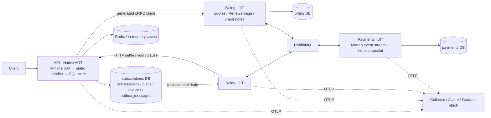

# Technical design — Subscription Management (.NET 10, Native AOT)

## 1. Executive summary

The original three-endpoint EF Core InMemory sample now has a Native AOT API with subscription lifecycle, invoices,
plans, search, PostgreSQL, optional Redis, RFC 9457 problems and OpenTelemetry. The API keeps explicit Npgsql SQL and
source-generated JSON. Three JIT services add gRPC, RabbitMQ/Wolverine messaging, renewal orchestration, cancellation
choreography and event-sourced payments. Aspire runs the combined local topology.

## 2. Architecture

`SubscriptionManagement.Contracts` holds plain records plus `billing.proto`; it has no runtime package dependencies.
The API compiles the client and Billing the server. Existing `/renew` and `/pay` remain synchronous/manual; only the
new `/renewals` flow uses automatic collection. Without `Billing:GrpcAddress` or `Outbox:Enabled`, it returns 503.
See [README](../README.md) for resource names, every operational setting and run commands.

## 3. API and service boundaries

The API keeps vertical slices (`*Endpoint`, `*Handler`, domain classes, per-table SQL stores), explicit validators and
one exception/problem pipeline. It is the only writer of subscriptions, plans and invoices. Relay adapts broker
commands into API HTTP calls so domain transitions, row locks and cache invalidation stay in that write path.

Billing owns quotes, renewal process state and credit notes. `BillingService.GetRenewalQuote` is pure arithmetic;
`GetRenewal` reads the retained saga row. Cleartext HTTP/2 gRPC uses port 5138; HTTP/1.1 REST/probes use 5128. API calls
have a two-second deadline. Decimals cross gRPC as invariant strings and dates as `yyyy-MM-dd`.
Payments owns payment streams and their inline snapshots. Its only business writes append events; read endpoints
expose a snapshot or the oldest-first history. Relay has no independent business model, only durable envelopes.

## 4. Native AOT strategy

The API uses `CreateSlimBuilder`, generated request delegates, source-generated JSON and build-time protobuf code.
Wolverine, EF Core and Marten stay in JIT services because they generate code at runtime. Contracts remains AOT-compatible.
New API wire/cache/problem types must be registered in `AppJsonSerializerContext`; trim/AOT warnings remain errors.
The API/migrator native images do not imply an AOT guarantee for Billing, Payments or Relay.

The pre-existing `Microsoft.DotNet.ILCompiler` 10.0.14 pin can conflict with the 10.0.12 runtime pack selected by SDK
10.0.401. Verification uses `-p:RuntimeFrameworkVersion=10.0.14` on native publish as a workaround; the compiler pin
is unchanged. `global.json` is currently absent although CI references it. See [ADR-001](adr/001-native-aot.md) and the
[Native AOT assessment](migration/native-aot-assessment.md) for the original constraints.
Local macOS native publish succeeded with a general ILCompiler warning and no trim/AOT diagnostics. Docker target
`api` still fails on the pre-existing pinned-compiler `PrivateSdkAssemblies` issue; no compiler pin was changed and
the runtime-version workaround is not a verified solution to that image-build failure.

## 5. Data ownership and transactions

| Owner / database | Data | Transaction boundary |
|---|---|---|
| API / `subscriptions` | Subscription/plan/invoice tables, `outbox_messages`, `invoices.payment_id` | Npgsql business write + raw outbox insertion |
| Billing / `billing` | `renewal_sagas`, `credit_notes`; Wolverine envelopes in `wolverine` schema | EF saga/credit-note change + outgoing messages |
| Payments / `payments` | Marten streams, `Payment` snapshots, envelopes in `payments` schema | Event append + inline snapshot + outgoing messages |
| Relay / `subscriptions` | Envelope tables in `relay` schema | Delete raw outbox rows + persist outgoing envelopes |

The API migrator applies V1–V6 with checksums and an advisory lock. V6 adds the raw outbox and nullable payment
reference; previous migrations remain immutable. Billing uses Wolverine-managed EF schema setup, Payments Marten
schema setup, and Relay Wolverine resource setup at startup. They do not extend the API's migration history.

API mutations use `SELECT … FOR UPDATE`; reads list columns explicitly. Search uses keyset `(start_date, id) DESC`
with limit+1 lookahead. Money stays decimal/NUMERIC. Subscription cache is cache-aside with five-minute default TTL,
updated/evicted only after commit; missing subscriptions are not cached.

Relay claims known raw outbox types with `FOR UPDATE SKIP LOCKED`, deletes rows and persists durable envelopes in the
same database transaction. Its sending agent then delivers to RabbitMQ. A rollback retains the raw rows. Unknown
types remain queued with a bounded warning; corrupt known payloads roll back the batch. This is at-least-once
messaging; durable inboxes and business idempotency protect redelivery, not a distributed exactly-once transaction.
Billing explicitly binds its outgoing ChargePayment, CancelPayment, SettleInvoice and CancelRenewal queues at startup;
Payments binds PaymentSucceeded, PaymentFailed and PaymentRefunded. Returned object collections hide these types from
startup discovery, so relying on the receiving service to declare them could lose messages on the first broker start.

## 6. Orchestrated renewal

1. `POST /subscriptions/{id}/renewals` obtains the taxed USD quote over gRPC before opening its transaction. It then
   advances the period and commits the invoice plus `InvoiceIssued` outbox row, returning 202 and the status Location.
2. Relay hands the event to RabbitMQ. Billing starts a saga whose id is the invoice id, creates a payment id, sends
   `ChargePayment`, and schedules a durable local `RenewalTimeout`.
3. Payments appends `ChargeRequested` and either captures, declines, or makes no reply. The simulated thresholds use
   the taxed invoice amount (`NoReplyAtOrAbove` first, then `DeclineAtOrAbove`).
4. On capture Billing moves to `Settling` and sends `SettleInvoice`. Relay calls `/invoices/{id}/settle`, then returns
   `InvoiceSettled` or `InvoiceSettlementRejected`; transient HTTP/database failures retry instead of becoming rejection.

| Current state + message | Next state | Outgoing work |
|---|---|---|
| New + InvoiceIssued | AwaitingPayment | ChargePayment + durable local timeout |
| AwaitingPayment + PaymentSucceeded | Settling | SettleInvoice |
| AwaitingPayment + PaymentFailed | Declined | CancelRenewal |
| AwaitingPayment + RenewalTimeout | TimedOut | CancelPayment + CancelRenewal |
| Settling + InvoiceSettled | Completed | None |
| Settling + InvoiceSettlementRejected | Compensated | CancelPayment |
| Other state/message pairs or missing saga | Unchanged | None |

Terminal rows remain queryable; `Version` is an EF concurrency token. Timeout/reply races retry against the latest
state. The timeout deliberately does not compensate `Settling`: an API outage past Relay's retry policy can leave that
state until an operator recovers/replays the dead-lettered command. Repeating settlement with the same payment id or
voiding an already-void invoice is a no-op. CancelRenewal pauses only after a successful void; 404/409 do not pause an
already-paid or missing invoice. See the [renewal sequence](../README.md#service-workflows).

## 7. Choreographed cancellation/refund and payment history

With outbox enabled, cancellation writes `SubscriptionCanceled` in the cancellation transaction only when an invoice
has a collected `payment_id`. Settlement takes the same subscription lock as cancellation before locking its invoice.
If cancellation happened first, the first successful settlement also writes `SubscriptionCanceled` in the settlement
transaction, ensuring a late capture triggers refund; repeating settlement does not enqueue another fact. Relay
publishes it; Payments finds captured payments for that subscription whose `PeriodEnd` is after the fact's `CanceledOn`
day. Each eligible stream appends `ChargeRefunded`, updates its inline snapshot and
persists `PaymentRefunded` in one transaction. Billing inserts a credit note with a unique payment id. There is no
refund coordinator; manual `/pay` does not gain this new behaviour.

Payment streams use the payment id. `ChargeRequested` records invoice/subscription/amount/currency/period end;
`ChargeCaptured`, `ChargeDeclined`, `ChargeCanceled` and `ChargeRefunded` explain subsequent status. Existing streams
ignore repeated charge commands. A cancel before charge can create a `ChargeCanceled`-only stream, so a later charge
cannot collect. Cancel after capture refunds; further cancel/refund attempts do nothing. Handlers fetch streams for
writing, retry stream-version/initial-stream conflicts, and apply pure decider logic. Snapshots are inline, so no
asynchronous projection daemon is required. Event schema changes will need explicit versioning/upcasting.

## 8. Security and compatibility

Authentication and authorization remain out of scope, including the settlement/void endpoints and service reads.
This is a trusted local-development topology; production exposure needs service authentication/authorization and TLS.
Parameterised SQL, boundary validation and opaque API error responses remain in place. Credentials come from configuration
or Aspire secrets; compose development defaults are not production credentials. No real payment-provider integration exists.
Existing API routes, DTO fields and synchronous flows remain compatible; new behaviour is opt-in outside Aspire.
The Java comparison remains in [java-feature-gap.md](migration/java-feature-gap.md).

## 9. Observability

Shared defaults export traces, metrics and logs only when OTLP is configured. The AppHost routes them through the
collector to Aspire and optionally Prometheus/Tempo/Loki/Grafana. The new services enable Wolverine and RabbitMQ
activity sources; Payments also exports Marten activity/event telemetry. Tempo generates service-graph and span metrics;
Prometheus scrapes PostgreSQL/Redis exporters and RabbitMQ.

The API stores W3C traceparent on each raw outbox row; Relay restores that parent per message and assigns its own
correlation id before durable publication. Wolverine/RabbitMQ and HttpClient carry the subsequent context. Invoice ids
are trace attributes (`invoice.id`, `wolverine.saga.id`), not metric labels. `saga-test.js` sends sampled traceparent
and logs invoice/trace ids. In Grafana's **Request flow** dashboard select the invoice and open the trace, or search its
logged trace id in Tempo Explore. Logs and exemplars link back to Tempo. Live verification found one connected renewal
trace across the API, Billing, Payments and Relay after enabling `Grpc.Net.Client` instrumentation, five messaging
service-graph edges and working RabbitMQ scraping. The handled-by-type panel uses Wolverine INTERNAL handler spans.
Error/dead-letter panels require failure traffic; an empty healthy-run result alone does not validate their queries.

API health bodies are JSON UP/DOWN: liveness process-only, readiness database-only, `/health` database + cache.
JIT services use ASP.NET health checks on `/health/live` and `/health/ready` (database). Health spans are excluded.

## 10. Testing and deployment

Unit tests cover domain/validator/cursor rules. API integration tests use the real migrator, Testcontainers PostgreSQL/
Redis and WebApplicationFactory; a programmable gateway isolates Billing, and a real gRPC host tests client behaviour.
Service tests use Testcontainers PostgreSQL, Wolverine tracking and disabled external transports: saga transitions and
races, atomic database/envelope commits, payment stream/snapshot contents, credit-note idempotency and Relay HTTP outcomes.
`SubscriptionManagement.SystemTests` runs the four services in one process on Testcontainers PostgreSQL (a database per service) and RabbitMQ:
the three saga outcomes, concurrent renewals, the cancel/refund choreography, outbox durability with the Relay stopped, and trace continuity
(one `ActivityListener` must see the inbound trace id on the API, gRPC client, Relay, broker publish/consume and Wolverine spans).
The live k6 `endpoints` scenario drives every route in parallel flows and fails when a route gets no traffic; the live k6 saga scenario creates fresh dated subscriptions and checks Completed/Declined/TimedOut and cancellation/refund;
it does not reset the databases. Settlement-rejected compensation is tested in the service suite, not deterministically in k6.
Two consecutive live saga runs on the same persistent databases each completed 3/3 iterations with 99/99 checks.
Commands and knobs are in the [README](../README.md#running-tests). These results do not imply complete panel/fault
coverage or successful Docker image builds.

Aspire owns the combined local topology, with `billing-db`/`payments-db` resources pointing to databases `billing`/
`payments`, `messaging` as RabbitMQ, and `billing`/`payments`/`relay` as projects. PostgreSQL budget validation requires
API pool + three service pools < max_connections − 3, with room left for migrations/exporters/sessions. PostgreSQL and
RabbitMQ volumes persist across runs. The existing compose, Helm/Kubernetes and CI images still package only the
API/migrator topology; new service images/resources, real gateway, authentication and operator replay tooling are not supplied.

## 11. ADRs

001 Native AOT · 002 Npgsql over EF · 003 SQL migrator · 004 Validation/problem details ·
[005 JIT messaging services](adr/005-jit-messaging-services.md) · [006 Raw outbox/Relay](adr/006-outbox-relay.md) ·
[007 Event-sourced payments](adr/007-event-sourced-payments.md).
