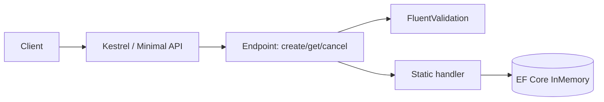
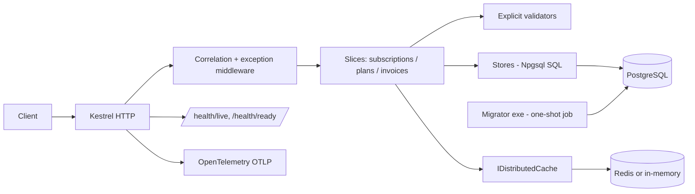

# Technical design — Subscription Management (.NET 10, Native AOT)

## 1. Executive summary
The repo is a 3-endpoint vertical-slice sample on .NET 10 with EF Core InMemory. We (a) make it Native-AOT publishable, (b) port the Java
reference's missing capabilities (lifecycle, plans, invoices, search, PostgreSQL, Redis cache, problem+json, health), and (c) add real tests.
The single most consequential finding: EF Core Native AOT is officially experimental, so the data layer moves to Npgsql + SQL (ADR-002).
Note: the ".NET 8" starting point in the brief did not exist; the code was already `net10.0`.

## 2. Current architecture


## 3. Target architecture

Layout (vertical slices, no mediator, no generic repository):
```
src/SubscriptionManagement/          API (Features/Subscriptions|Plans|Invoices, Infrastructure)
src/SubscriptionManagement.Migrator/ SQL migration runner (+ V*.sql embedded)
tests/SubscriptionManagement.UnitTests/
tests/SubscriptionManagement.IntegrationTests/   WebApplicationFactory + Testcontainers
```

## 4. Java vs .NET feature gap
See `docs/migration/java-feature-gap.md` (full matrix and compatibility decisions).

## 5. Native AOT strategy
Compatible: Minimal APIs (slim builder), health checks, source-gen JSON, Npgsql driver (verified by publish), problem details.
Incompatible/replaced: EF Core, EF InMemory, FluentValidation, DataAnnotations attributes. Source generation: `AppJsonSerializerContext` for all
request/response/cache/problem types; no reflection-based DI (explicit registrations). Trimming: default full trim under PublishAot; warnings are errors. Details: `native-aot-assessment.md`.

## 6. Dependency analysis
See `docs/migration/dotnet10-compatibility.md`.

## 7. Data layer
PostgreSQL 17. Schema = Java's V1–V4 (subscriptions with `current_period_*`, plans with seed, invoices). All state changes:
`BEGIN → SELECT … FOR UPDATE → domain rule → UPDATE/INSERT → COMMIT`, so concurrent cancels serialize (one 204, one 400).
Reads use explicit column lists (no `SELECT *`). Search is keyset `(start_date, id) DESC` with limit+1 lookahead and opaque cursor. Money: `decimal` ↔ `NUMERIC`.
Migrations: dedicated executable (ADR-003). Cache: cache-aside on subscription id, TTL 5 min, put on create/pause/resume/renew, evict on cancel, only after commit, 404 never cached.

## 8. Security
No authentication existed in either app; none is invented (out of scope, documented). Secure defaults: parameterised SQL only, request body size default limits, `ProblemDetails` never
leaks stack traces, connection strings only from configuration/env (no secrets committed; compose uses dev-only defaults overridable by env), containers run as non-root, sensitive values not logged.
Negative tests: malformed JSON/ids/dates, oversize fields, SQL-metacharacter input, unknown cursor/status, illegal transitions.

## 9. Observability
JSON console structured logging with `traceId` scope; `X-Trace-Id` correlation; OpenTelemetry traces+metrics (ASP.NET Core, HttpClient, Npgsql) exported via OTLP only when `OTEL_EXPORTER_OTLP_ENDPOINT` is set; health: `/health/live` (process), `/health/ready` (Postgres, Redis when configured).

## 10. Testing strategy
Unit: domain state machines, period math, validators, cursor codec. Integration: `WebApplicationFactory<Program>` against Testcontainers PostgreSQL (schema by the real migrator) and Redis; covers all endpoints,
error shapes, caching hit/evict, concurrency. AOT smoke: script publishes the native binary, starts it against containers and exercises critical endpoints. No EF InMemory anywhere.

## 11. Deployment
`dotnet publish -c Release -r linux-x64` (PublishAot in csproj). Multi-stage Dockerfile → `runtime-deps` image, non-root, HTTP 8080. `compose.yaml`: postgres, redis, migrator (one-shot), app (depends on migrator completion).

## 12. Risks
| Risk | Impact | Probability | Mitigation |
|---|---|---|---|
| Npgsql/Redis/OTel emit AOT warnings | Med | Med | Publish early; fall back to lighter alternatives; document any justified suppression |
| Hand SQL drift from schema | Med | Low | Testcontainers tests on real schema |
| Clients depend on old error bodies | Med | Low | Additive `error` member; key-casing change documented |
| Sandbox lacks native toolchain (clang/zlib) for AOT | High | Low-Med | Verify in Phase 2 before large investment |
| Docker unavailable in CI for tests | Med | Low | Tests fail loudly; documented prerequisite |
| Perf numbers not comparable (no .NET 8 build exists) | Low | High | Mark "Not measured" |

## 13. ADRs
001 Native AOT · 002 Npgsql over EF · 003 SQL migrator · 004 Validation/problem details.
